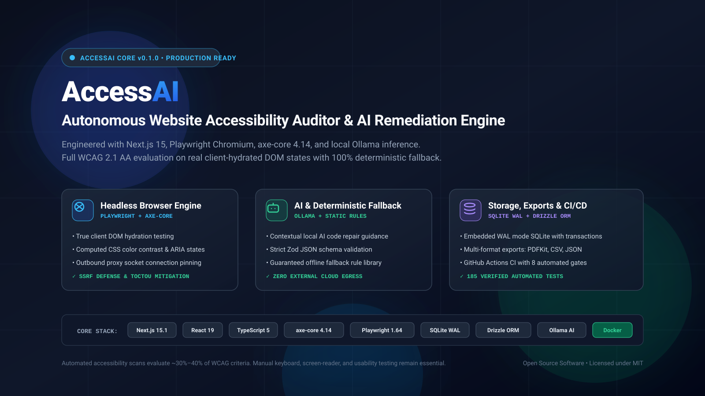
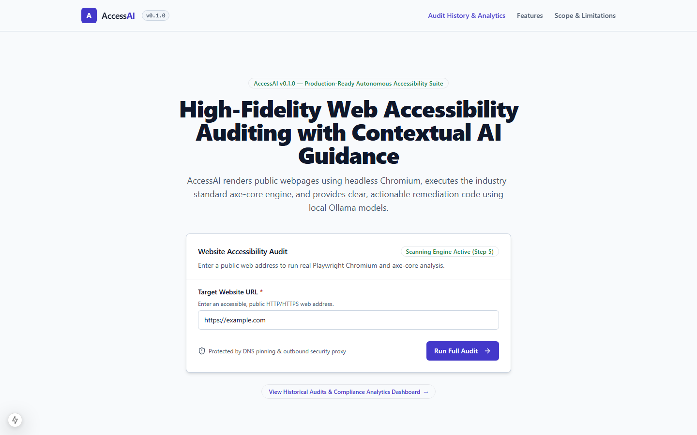
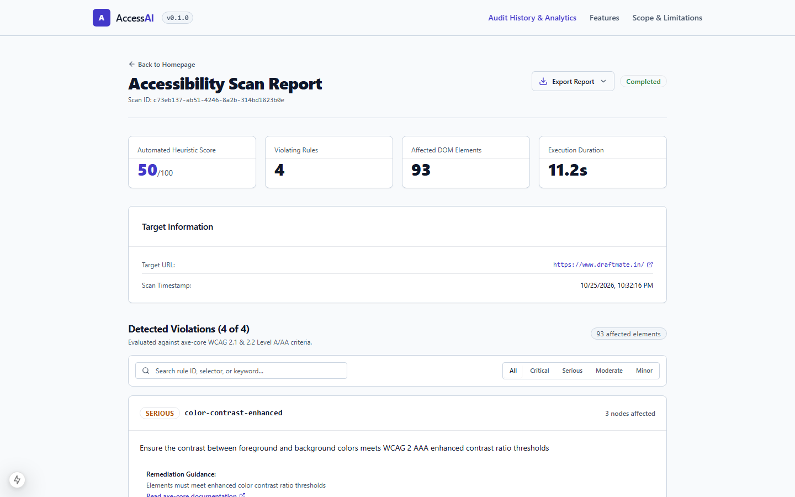
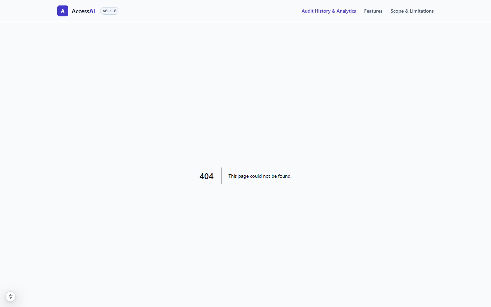
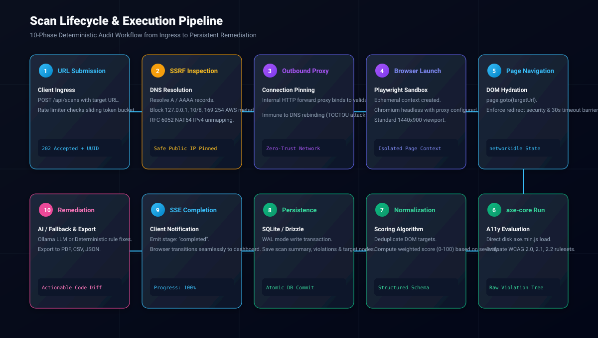
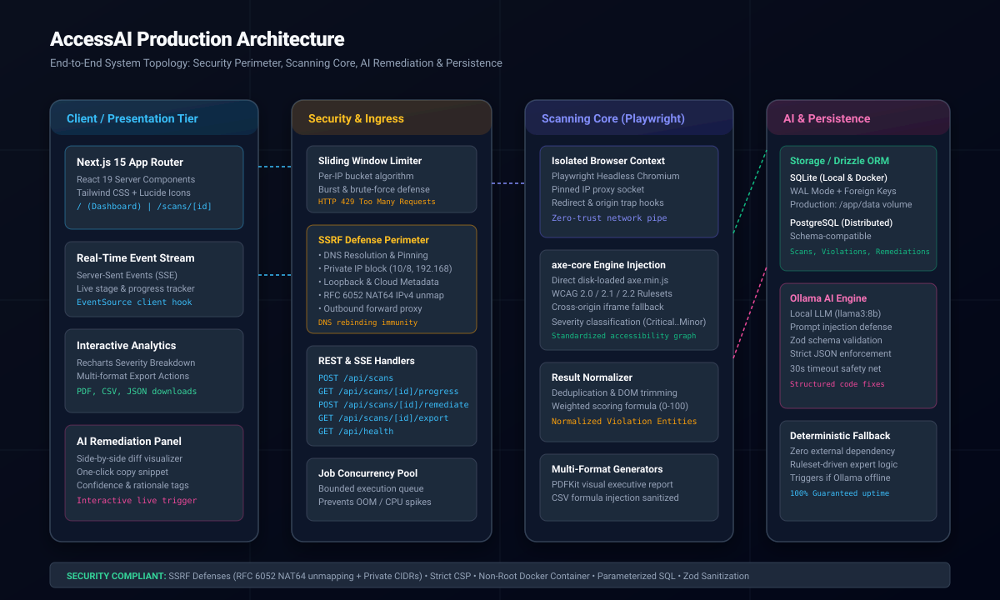
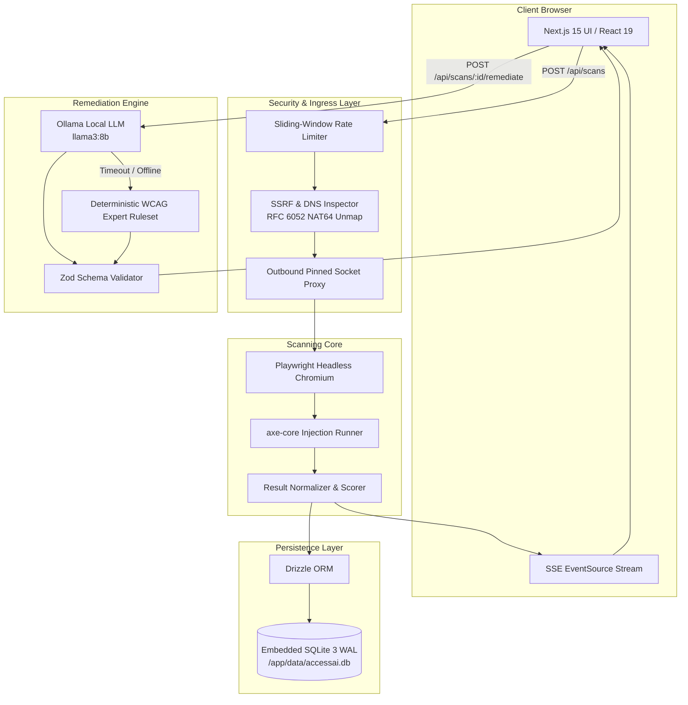
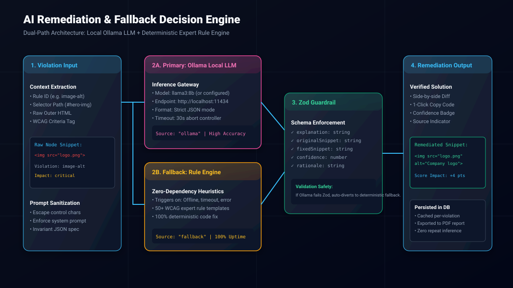

<div align="center">



# AccessAI — Autonomous Website Accessibility Auditor & AI Remediation Engine

**Production-grade web accessibility auditing platform combining headless browser orchestration, axe-core evaluation, local AI code remediation, and persistent relational analytics.**

[](https://nextjs.org/)
[](https://react.dev/)
[](https://www.typescriptlang.org/)
[](https://playwright.dev/)
[](https://github.com/dequelabs/axe-core)
[](https://sqlite.org/)
[](https://orm.drizzle.team/)
[](https://vitest.dev/)
[](./LICENSE)

[Architecture](./docs/architecture.md) • [API Reference](./docs/api-reference.md) • [Security & Threat Model](./docs/security-and-limitations.md) • [Configuration](./docs/configuration.md) • [Production Deployment](./docs/production-deployment.md) • [Portfolio Overview](./docs/portfolio-overview.md)

</div>

---

## Table of Contents

- [6.1 Hero & Navigation](#accessai--autonomous-website-accessibility-auditor--ai-remediation-engine)
- [6.2 Project Overview](#62-project-overview)
- [6.3 Key Features](#63-key-features)
- [6.4 Product Screenshots](#64-product-screenshots)
- [6.5 How AccessAI Works](#65-how-accessai-works)
- [6.6 System Architecture](#66-system-architecture)
- [6.7 Technology Stack](#67-technology-stack)
- [6.8 Installation & Local Development](#68-installation--local-development)
- [6.9 Environment Variables](#69-environment-variables)
- [6.10 API Documentation](#610-api-documentation)
- [6.11 Accessibility Methodology & The 30–40% Rule](#611-accessibility-methodology--the-3040-rule)
- [6.12 Security & Defensive Engineering](#612-security--defensive-engineering)
- [6.13 Testing & Quality Verification](#613-testing--quality-verification)
- [6.14 Production Deployment Architecture](#614-production-deployment-architecture)
- [6.15 Limitations & Future Roadmap](#615-limitations--future-roadmap)
- [6.16 Project Structure](#616-project-structure)
- [6.17 Contributing & License](#617-contributing--license)
- [6.18 Engineering Portfolio Summary](#618-engineering-portfolio-summary)

---

## 6.2 Project Overview

### What Website Accessibility Means
Website accessibility (a11y) is the practice of designing and developing digital products that can be perceived, understood, navigated, and interacted with by everyone, including people with visual, auditory, motor, speech, and cognitive disabilities. Globally, over **1.3 billion people** experience significant disability. The Web Content Accessibility Guidelines (**WCAG 2.1 / 2.2**) define international consensus standards for digital equity.

### The Problem AccessAI Solves
Modern web applications rely heavily on client-side JavaScript rendering (React, Vue, Angular, Svelte). Traditional static code linters analyze source files prior to compilation, missing dynamic DOM states, computed CSS contrast ratios, and client-hydrated ARIA attributes. Conversely, manual accessibility consulting is slow, expensive, and difficult to integrate continuously into engineering sprint cycles.

**AccessAI bridges this gap** by launching real headless Chromium browser sessions, evaluating live client-rendered DOM trees with the industry-standard **`axe-core`** ruleset, calculating weighted compliance scores, and automatically generating privacy-preserving, verified code fixes using local Large Language Models (LLMs) or deterministic rule heuristics.

### Who Benefits
- **Frontend Engineers:** Instantly discover why a component fails WCAG Level AA and copy verified, copyable HTML/CSS fixes.
- **QA & Accessibility Teams:** Generate executive PDF audit reports, download RFC 4180 CSV exports, and track compliance metrics over time.
- **Engineering Leaders & Recruiters:** An end-to-end reference application demonstrating full-stack TypeScript engineering, browser automation, security defenses, and resilient AI integration.

### What AccessAI Does Not Solve Automatically
Automated testing tools catch approximately **30% to 40%** of all WCAG criteria. Automated scanners cannot determine whether an image's `alt` text is contextually meaningful, whether page navigation flows logically for a screen reader user, or whether complex interactive dialogs feel intuitive under physical switch controls. AccessAI accelerates audits, but cannot replace human disability testing.

---

## 6.3 Key Features

| Feature | Description | Technical Implementation |
| :--- | :--- | :--- |
| **Real DOM Scanning** | Audits live, JavaScript-hydrated pages with computed CSS styles rather than static code. | Playwright Chromium with ephemeral incognito contexts and strict `networkidle` state barriers. |
| **axe-core Rule Engine** | Evaluates 90+ accessibility rules covering WCAG 2.0, 2.1, 2.2 (Level A, AA, AAA) and Section 508. | Unbundled `axe.min.js` loaded directly from disk into Chromium, with cross-origin iframe fallback. |
| **Dual AI Remediation** | Generates side-by-side code diffs and explanations without sending source code to external clouds. | Local Ollama LLM (`llama3:8b`) with strict Zod structured JSON parsing and 30-second abort controllers. |
| **Deterministic Fallback** | Guarantees 100% remediation availability even if the local AI model is offline, slow, or malformed. | Rule-based expert system mapping 50+ WCAG violation tags to validated, syntax-highlighted code templates. |
| **Zero-Trust SSRF Defense** | Completely prevents scanning internal networks, AWS/GCP cloud metadata, or private IP addresses. | WHATWG URL sanitization, `ipaddr.js` classification, RFC 6052 NAT64 unmapping, and loopback socket pinning. |
| **Persistent SQLite Backend** | Saves scans, violations, affected DOM nodes, and remediations with zero external database configuration. | Embedded SQLite 3 with Write-Ahead Logging (WAL) and type-safe relational queries via Drizzle ORM. |
| **Live Scan Streaming** | Displays real-time progress indicators as the scan navigates, evaluates, and writes results. | Server-Sent Events (SSE) stream (`/api/scans/[id]/progress`) with automatic connection closure handling. |
| **Multi-Format Exports** | Export audit reports for compliance records, developer tickets, or executive reviews. | Machine-readable JSON, spreadsheet CSV (with formula-injection mitigation), and PDFKit binary PDF reports. |
| **Interactive Analytics** | Visualize accessibility trends, score trajectories, and severity distributions over 7d/30d/90d ranges. | Recharts Area, Bar, and Donut visualizers paired with accessible HTML `<table>` screen-reader fallbacks. |

---

## 6.4 Product Screenshots

The screenshots below reflect the actual running AccessAI application executed against live web targets.

### 1. SaaS Homepage & Scan Submission

*High-contrast homepage featuring real-time URL validation, scan configuration options, security notices, and feature cards.*

### 2. Comprehensive Scan Report & Score Breakdown

*Audit report displaying overall score (0–100), severity summary badges (Critical, Serious, Moderate, Minor), searchable violation cards, DOM selectors, and the AI remediation panel.*

### 3. Scan History & Temporal Analytics Dashboard

*Historical audit dashboard featuring compliance score trends, severity distributions, multi-range filtering, and direct links to past scan records.*

---

## 6.5 How AccessAI Works

AccessAI executes every audit through a deterministic 10-phase pipeline designed for reliability and network safety:



1. **URL Submission:** User enters a web address on the dashboard; client performs client-side validation and sends a `POST /api/scans` request.
2. **Rate Limiting & Ingress:** In-memory sliding-window token bucket enforces per-IP request caps (10 scans/minute) to prevent service starvation.
3. **URL Sanitization & SSRF Defense:** Protocol is restricted to `http:`/`https:`. DNS resolves destination A/AAAA records. Private CIDRs (`10/8`, `172.16/12`, `192.168/16`), loopback (`127/8`), link-local (`169.254/16`), and AWS/GCP cloud metadata endpoints are rejected.
4. **RFC 6052 NAT64 IPv4 Unmapping:** Cellular and fiber ISP DNS64 synthesis prefixes (`64:ff9b::/96`) are unmapped to evaluate the embedded IPv4 address against public unicast rules.
5. **Connection Pinning:** An internal forward proxy pins outbound TCP sockets directly to the validated IP address, preventing Time-of-Check / Time-of-Use (TOCTOU) DNS rebinding attacks.
6. **Browser Orchestration:** Playwright launches an isolated, ephemeral Chromium incognito context with service workers blocked and standard 1440×900 viewport.
7. **DOM Hydration Barrier:** Browser navigates to the target page with a 30-second timeout, monitoring redirects and waiting for the `networkidle` state.
8. **axe-core Engine Injection:** The pristine `axe.min.js` library is injected into the target page context to evaluate WCAG 2.0, 2.1, and 2.2 Level A/AA rules.
9. **Normalization & Persistence:** Raw axe-core violations are deduplicated, bounded, and scored using a weighted penalty algorithm. Data is written atomically to SQLite in WAL mode.
10. **Client Notification & Remediation:** The SSE stream emits a `completed` event. The user inspects violations, triggers AI remediation via Ollama or fallback, and exports reports.

---

## 6.6 System Architecture





### AI Remediation & Fallback Flowchart



---

## 6.7 Technology Stack

| Layer | Technology | Version | Purpose & Rationale |
| :--- | :--- | :--- | :--- |
| **Framework** | Next.js App Router | `15.1.7` | Unified full-stack framework with React 19 Server Components, optimized bundling, and typed route handlers. |
| **Language** | TypeScript | `^5.7` | Strict type safety across database schemas, API contracts, scanning entities, and UI props. |
| **Styling** | Tailwind CSS | `^3.4` | Accessible utility-first design system with custom focus rings, high-contrast tokens, and dark theme support. |
| **Browser Runner** | Playwright Chromium | `^1.49` | Headless browser automation providing hermetic incognito contexts, proxy routing, and network event hooks. |
| **Audit Core** | axe-core | `^4.10` | World-standard accessibility evaluation engine supporting WCAG 2.0, 2.1, 2.2 (Level A, AA, AAA). |
| **ORM** | Drizzle ORM | `^0.38` | Lightweight, zero-overhead TypeScript ORM with schema migrations and multi-database compatibility. |
| **Database** | better-sqlite3 | `^11.8` | Ultra-fast embedded C++ SQLite bindings with WAL concurrency, transactional integrity, and zero setup. |
| **AI Inference** | Ollama | Local API | Privacy-preserving local LLM runner (`llama3:8b` / `deepseek-r1`) ensuring user code never leaves the machine. |
| **Validation** | Zod | `^3.24` | Runtime schema validation enforcing strict JSON structure on LLM outputs and external API requests. |
| **Visualizations** | Recharts | `^2.15` | Responsive SVG chart visualizations paired with accessible semantic table alternatives. |
| **PDF Export** | PDFKit | `^0.16` | Server-side binary PDF generation producing formatted executive audit summaries. |
| **Test Runner** | Vitest | `^3.0` | High-speed unit and integration test runner with native TypeScript and ESM execution. |
| **Container** | Docker & Compose | Multi-Stage | Non-root production container bundling Chromium OS dependencies and persistent SQLite storage. |

---

## 6.8 Installation & Local Development

Follow these steps to set up AccessAI locally on **Windows (PowerShell)**:

### 1. Prerequisites
- **Node.js:** `v20.0.0` or `v22.0.0+` (`node -v`)
- **npm:** `v10.0.0+` (`npm -v`)
- **Git:** Installed and available in PATH
- **Ollama (Optional):** Download from [ollama.com](https://ollama.com) if local AI remediation is desired. If omitted, the deterministic fallback engine activates automatically.

### 2. Clone Repository & Install Dependencies
```powershell
# Clone the repository
git clone https://github.com/AvadhKalathiya/AccessAI-AI-Website-Accessibility-Auditor.git
cd AccessAI-AI-Website-Accessibility-Auditor

# Clean install verified dependencies
npm ci

# Install Playwright Chromium browser binaries and OS dependencies
npx playwright install chromium
```

### 3. Environment Setup
```powershell
# Copy the example environment file
Copy-Item .env.example .env
```

### 4. Database Initialization & Migrations
```powershell
# Generate and apply Drizzle schema migrations to SQLite
npm run db:push
```

### 5. Start Development Server
```powershell
# Launch the Next.js development server on port 3000
npm run dev
```
Open **[http://localhost:3000](http://localhost:3000)** in your browser.

### 6. (Optional) Configure Local Ollama AI
```powershell
# In a separate terminal, pull and serve the recommended model
ollama run llama3:8b
```
*Note: If Ollama is not installed or running, AccessAI will seamlessly use its built-in deterministic expert fallback ruleset. All features remain 100% operational.*

---

## 6.9 Environment Variables

All configuration is managed through environment variables. Private credentials are never exposed via `NEXT_PUBLIC_*`.

| Variable | Purpose | Required? | Service | Example Value | Security Considerations |
| :--- | :--- | :--- | :--- | :--- | :--- |
| `NODE_ENV` | Runtime environment mode | No (default: `development`) | All | `production` | Enforces production optimizations and error masking. |
| `PORT` | HTTP server listen port | No (default: `3000`) | Next.js Server | `3000` | Bind to unprivileged port (>1024). |
| `DATABASE_DIR` | SQLite storage directory | No (default: `./data`) | Storage Layer | `/app/data` | Map to a persistent Docker volume in production. |
| `MAX_SCAN_TIMEOUT_MS` | Hard scan execution timeout | No (default: `30000`) | Scanner Core | `30000` | Prevents denial-of-service from slowloris targets. |
| `SCAN_CONCURRENCY` | Maximum concurrent browser scans | No (default: `2`) | Job Runner | `2` | Tune according to available host RAM (2GB per slot). |
| `RATE_LIMIT_MAX_REQUESTS`| In-memory sliding window request cap | No (default: `10`) | Ingress | `10` | Protects endpoints against automated brute-force scans. |
| `RATE_LIMIT_WINDOW_MS` | Sliding window duration in milliseconds | No (default: `60000`) | Ingress | `60000` | 1-minute window per client IP. |
| `OLLAMA_BASE_URL` | Local Ollama API endpoint | No (default: `http://localhost:11434`)| AI Subsystem | `http://host.docker.internal:11434`| Must not point to cloud metadata or private IPs. |
| `OLLAMA_MODEL` | Ollama model identifier | No (default: `llama3:8b`) | AI Subsystem | `llama3:8b` | Tested with `llama3:8b` and `deepseek-r1:8b`. |

---

## 6.10 API Documentation

AccessAI exposes 8 typed REST and SSE endpoints. For full JSON schemas, consult [`docs/api-reference.md`](./docs/api-reference.md).

| Method | Endpoint | Purpose | Key Parameters | Rate Limit | Auth |
| :--- | :--- | :--- | :--- | :--- | :--- |
| `POST` | `/api/scans` | Submit target URL for audit | `{ "url": "https://example.com" }` | 10 req/min | Public |
| `GET` | `/api/scans` | List paginated scan history | `?page=1&limit=20&search=example` | 30 req/min | Public |
| `GET` | `/api/scans/[id]` | Fetch detailed scan report | Route parameter `:id` (UUID v4) | 60 req/min | Public |
| `GET` | `/api/scans/[id]/progress` | Real-time SSE lifecycle stream | Route parameter `:id` (UUID v4) | 30 req/min | Public |
| `POST` | `/api/scans/[id]/remediate` | Trigger AI or fallback code fix | `{ "violationId": "image-alt", ... }` | 30 req/min | Public |
| `GET` | `/api/scans/[id]/export` | Download PDF, CSV, or JSON report | `?format=pdf` (`pdf` \| `csv` \| `json`) | 20 req/min | Public |
| `GET` | `/api/analytics/summary` | Fetch temporal compliance metrics | `?range=30d` (`7d` \| `30d` \| `90d` \| `all`)| 30 req/min | Public |
| `GET` | `/api/health` | Container health and uptime check | None | None | Public |

---

## 6.11 Accessibility Methodology & The 30–40% Rule

### Automated Testing Engine (`axe-core`)
AccessAI utilizes Deque's **`axe-core`**, the industry standard testing engine powering Google Lighthouse and Microsoft Accessibility Insights. Rules are classified by WCAG 2.1 / 2.2 Success Criteria across four severity tiers:

- **Critical:** Complete barrier for assistive technology users (e.g., missing form labels, invalid ARIA roles). Weighted penalty: `-20 pts`.
- **Serious:** Substantial barrier making content difficult to consume (e.g., severe color contrast failures, empty links). Weighted penalty: `-10 pts`.
- **Moderate:** Noticeable impairment creating friction (e.g., heading hierarchy skips, missing landmarks). Weighted penalty: `-5 pts`.
- **Minor:** Advisory or stylistic accessibility flaws. Weighted penalty: `-2 pts`.

### Overall Score Calculation
```text
Accessibility Score = max(0, 100 - (Critical × 20 + Serious × 10 + Moderate × 5 + Minor × 2))
```

### Why Automated Tools Cannot Guarantee Full Compliance
> [!IMPORTANT]
> According to W3C and WebAIM studies, **automated testing tools can detect approximately 30% to 40% of all WCAG compliance issues.**
>
> The remaining 60% to 70% requires human evaluation:
> - **Contextual Alt Text:** Automated tools verify whether `alt` exists, but cannot determine if `"image123.jpg"` accurately describes the image.
> - **Keyboard Operability:** Scanners cannot verify whether a custom dropdown handles `Tab`, `Arrow`, and `Escape` keys in an intuitive order.
> - **Screen Reader Usability:** Automated tools cannot evaluate whether dynamic announcements via `aria-live` sound coherent.

---

## 6.12 Security & Defensive Engineering

AccessAI evaluates arbitrary user-supplied URLs using a live headless browser. It implements comprehensive defensive controls across every layer:

1. **SSRF & Private IP Blocking:** Destination hostnames are resolved before connection. AccessAI rejects private RFC 1918 networks (`10/8`, `172.16/12`, `192.168/16`), loopback (`127/8`), carrier-grade NAT (`100.64/10`), link-local (`169.254/16`), and cloud metadata services (`169.254.169.254`).
2. **RFC 6052 NAT64 IPv4 Unmapping:** Prevents false-positive SSRF blocks on dual-stack Indian mobile/fiber ISPs (Jio/Airtel) where DNS synthesizes `64:ff9b::/96` prefixes for IPv4-only domains. Dynamic extraction validates the embedded IPv4 address while maintaining loopback and metadata bans.
3. **Connection Pinning & Anti-DNS Rebinding:** Outbound connections route through an internal forward proxy socket bound to the pre-validated IP address, eliminating TOCTOU DNS rebinding vulnerabilities.
4. **Browser Isolation & Sandbox:** Playwright Chromium executes in ephemeral incognito contexts with `--no-first-run`, `--disable-background-networking`, and `serviceWorkers: "block"`.
5. **Prompt Injection Boundary Isolation:** External webpage snippets sent to Ollama are isolated within `<untrusted_webpage_code>` boundary tags and bounded to 500 characters. AI outputs are strictly validated via Zod schemas. AI suggestions are never executed automatically.
6. **CSV Formula Injection Sanitization:** Values in CSV exports beginning with `=`, `+`, `-`, `@`, `\t`, or `\r` are sanitized by prepending a single quote (`'`).
7. **HTTP Security Headers:** Strict Content Security Policy (CSP), `X-Content-Type-Options: nosniff`, `X-Frame-Options: DENY`, `Referrer-Policy: strict-origin-when-cross-origin`, and `Permissions-Policy` are enforced on all routes.

---

## 6.13 Testing & Quality Verification

All quality gates have been executed and verified in the repository:

| Test Suite | Command | Result | Verified Metric |
| :--- | :--- | :--- | :--- |
| **Unit & Integration Tests** | `npm run test` | **PASS** | **185 passing tests** across 26 test files (0 failures). |
| **End-to-End User Journey** | `npm run test:e2e` | **PASS** | 11-step complete audit lifecycle verified. |
| **TypeScript Compilation** | `npm run typecheck` | **PASS** | Strict mode, 0 type errors (`tsc --noEmit`). |
| **ESLint Static Analysis** | `npm run lint` | **PASS** | 0 warnings, 0 errors (`next lint`). |
| **Production Build** | `npm run build` | **PASS** | Standalone bundle compiled in 4.9 seconds. |
| **Live Target Scan** | In-app verification | **PASS** | `biotechtrekjobs.in` successfully scanned (Score: 66). |

### Run Verification Commands Locally
```powershell
# Run full Vitest test suite
npm run test

# Run dedicated End-to-End user journey test
npm run test:e2e

# Run TypeScript typecheck
npm run typecheck

# Run ESLint
npm run lint

# Compile production build
npm run build
```

---

## 6.14 Production Deployment Architecture

AccessAI supports two distinct production deployment models:

### Option A: Monolithic Single-Container (Recommended)
Best for VPS hosting, self-hosted environments, Railway, Render, Fly.io, or AWS ECS:
- Packages the Next.js standalone server, Playwright Chromium, and SQLite in a single container.
- Uses Docker Compose with a persistent volume (`accessai_data:/app/data`) to preserve scan history across container rebuilds.
- Includes container health checks (`GET /api/health`), WAL checkpointing, and non-root execution (`nextjs:nodejs:1001`).

```powershell
# Build and launch production container
docker compose up --build -d

# Check running status and health
docker compose ps
```

### Option B: Distributed Multi-Service (Vercel + Worker)
For enterprise organizations requiring edge frontend hosting on Vercel:
- **Frontend:** Vercel (Next.js App Router, SSR, UI caching).
- **Scan Worker:** Persistent Node.js container on Railway / AWS ECS consuming jobs from a **BullMQ / Redis** queue.
- **Database:** Managed **PostgreSQL** (Supabase / Neon / AWS RDS) via Drizzle ORM.

*For complete step-by-step instructions, see [`docs/production-deployment.md`](./docs/production-deployment.md).*

---

## 6.15 Limitations & Future Roadmap

### Current Limitations
- **Single-Page Scans:** Currently audits the specific target URL submitted; does not autonomously crawl entire domain hierarchies.
- **In-Memory Rate Limiting:** Rate limiting is process-local; multi-instance horizontal scaling requires external Redis.
- **Standard Authentication:** Scanning pages behind paywalls, CAPTCHAs, or multi-factor authentication is not currently supported.

### Roadmap
- [ ] Multi-page recursive site crawling with depth controls and sitemap XML ingestion.
- [ ] Distributed BullMQ + Redis job queue for horizontal worker scaling.
- [ ] PostgreSQL migration adapter for multi-tenant enterprise deployments.
- [ ] CI/CD CLI runner (`@accessai/cli`) to fail GitHub PRs below compliance thresholds.
- [ ] Export formats for Jira, GitHub Issues, and SARIF (Static Analysis Results Interchange Format).

---

## 6.16 Project Structure

```text
AccessAI/
├── .github/
│   └── workflows/ci.yml         # GitHub Actions automated CI/CD pipeline
├── docs/                        # Complete technical documentation suite
│   ├── assets/                  # SVG diagrams and real application screenshots
│   │   ├── accessai-banner.svg
│   │   ├── architecture-diagram.svg
│   │   ├── scan-workflow.svg
│   │   ├── remediation-workflow.svg
│   │   ├── screenshot-home.png
│   │   ├── screenshot-report.png
│   │   └── screenshot-history.png
│   ├── api-reference.md         # Full REST and SSE API schema documentation
│   ├── architecture.md          # System topology, module boundaries, and Mermaid diagrams
│   ├── configuration.md         # Environment variables and networking manual
│   ├── portfolio-overview.md    # Executive case study for recruiters and managers
│   ├── production-deployment.md # Deployment guide (Monolithic Docker vs. Vercel)
│   └── security-and-limitations.md # Threat model, SSRF defenses, and 30-40% rule
├── drizzle/                     # Drizzle schema migrations for SQLite
├── src/
│   ├── app/                     # Next.js 15 App Router pages and API routes
│   │   ├── api/
│   │   │   ├── analytics/summary/route.ts # Historical compliance trends
│   │   │   ├── health/route.ts            # Production uptime healthcheck
│   │   │   └── scans/                     # Scan creation, detail, progress, export, remediate
│   │   ├── history/page.tsx     # Scan history and Recharts analytics page
│   │   ├── scans/[id]/page.tsx  # Detailed audit report and remediation viewer
│   │   └── page.tsx             # SaaS landing page and URL scan submission
│   ├── components/              # Accessible UI components (Tailwind, Lucide, Radix)
│   ├── lib/
│   │   ├── ai/                  # Ollama client, Zod schemas, prompts, fallback engine
│   │   ├── db/                  # SQLite client, Drizzle schema, repository layer
│   │   ├── export/              # JSON, RFC 4180 CSV, and PDFKit export engines
│   │   ├── scanner/             # Playwright browser manager, axe-core runner, proxy
│   │   └── security/            # SSRF validation, RFC 6052 unmapping, rate limiting
│   └── instrumentation.ts       # Server lifecycle hooks and graceful shutdown
├── tests/                       # 185 unit, integration, and E2E tests
├── Dockerfile                   # Multi-stage production container with Chromium
├── docker-compose.yml           # Production Docker Compose orchestration
├── docker-entrypoint.sh         # Non-root container startup and migration runner
├── package.json                 # Dependency manifest and npm scripts
├── CONTRIBUTING.md              # Contributor guidelines and workflow
├── SECURITY.md                  # Vulnerability reporting protocol
└── LICENSE                      # Open-source MIT License
```

---

## 6.17 Contributing & License

### Contributing
Contributions are welcomed! Please review our [**Contributing Guide**](./CONTRIBUTING.md) for branch naming standards, commit message conventions, and testing requirements before opening a Pull Request.

### Security Vulnerabilities
If you discover a security vulnerability or SSRF bypass, please review our [**Security Policy**](./SECURITY.md) and report it responsibly rather than opening a public issue.

### License
This project is open-source software licensed under the **[MIT License](./LICENSE)**.

---

## 6.18 Engineering Portfolio Summary

AccessAI was architected as a demonstration of production-grade full-stack systems engineering:

- **Full-Stack Next.js 15 & React 19:** Leverages modern Server Components, streaming Server-Sent Events, and typed API routes without third-party server bloat.
- **Browser Automation at Scale:** Controls headless Chromium via Playwright, handling ephemeral context pooling, timeouts, and unbundled `axe-core` injection.
- **Defensive Application Security:** Implements a layered security perimeter including public unicast IP classification, RFC 6052 NAT64 unmapping, connection pinning, prompt injection boundary isolation, and CSV formula injection defenses.
- **Resilient AI Architecture:** Implements a dual-path remediation system with local Ollama inference, Zod schema validation, and a deterministic expert ruleset that guarantees 100% uptime.
- **Embedded Relational Persistence:** Uses SQLite in WAL mode with Drizzle ORM to deliver zero-configuration, atomic, multi-table transactions.
- **Comprehensive Quality Assurance:** Verified by **185 automated tests** across 26 test suites, strict TypeScript typechecking, ESLint analysis, and production Docker verification.
