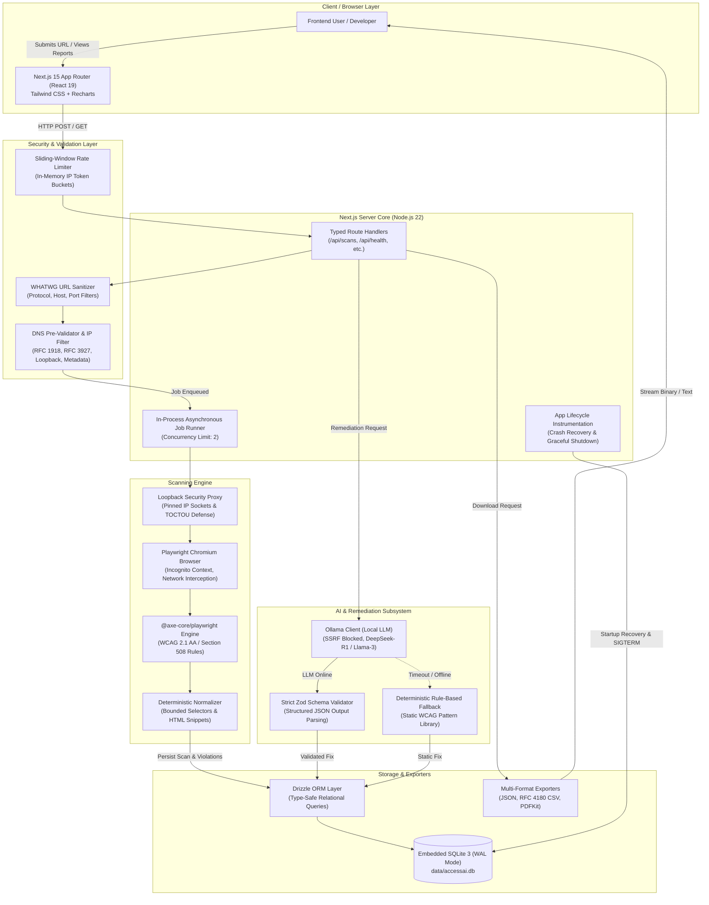
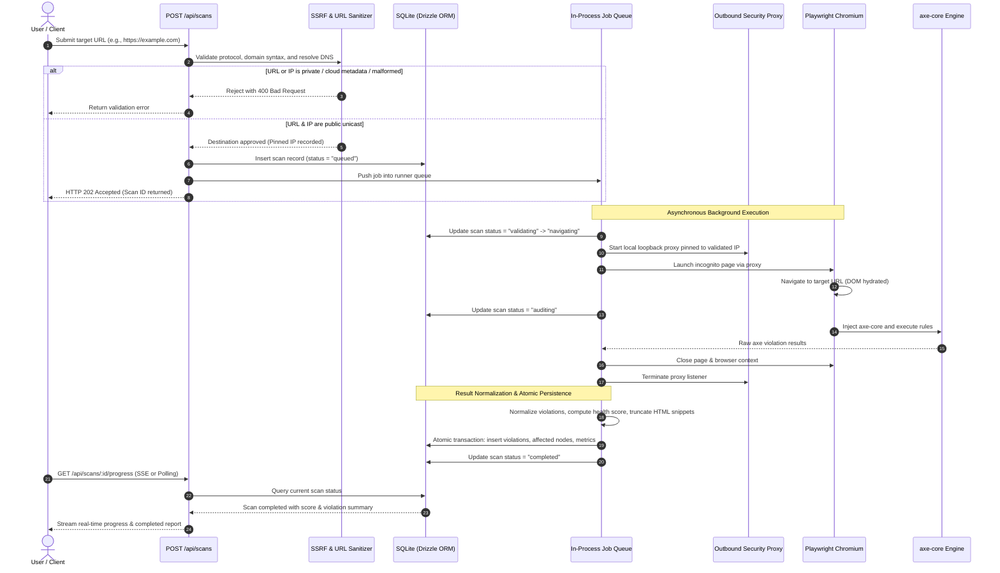
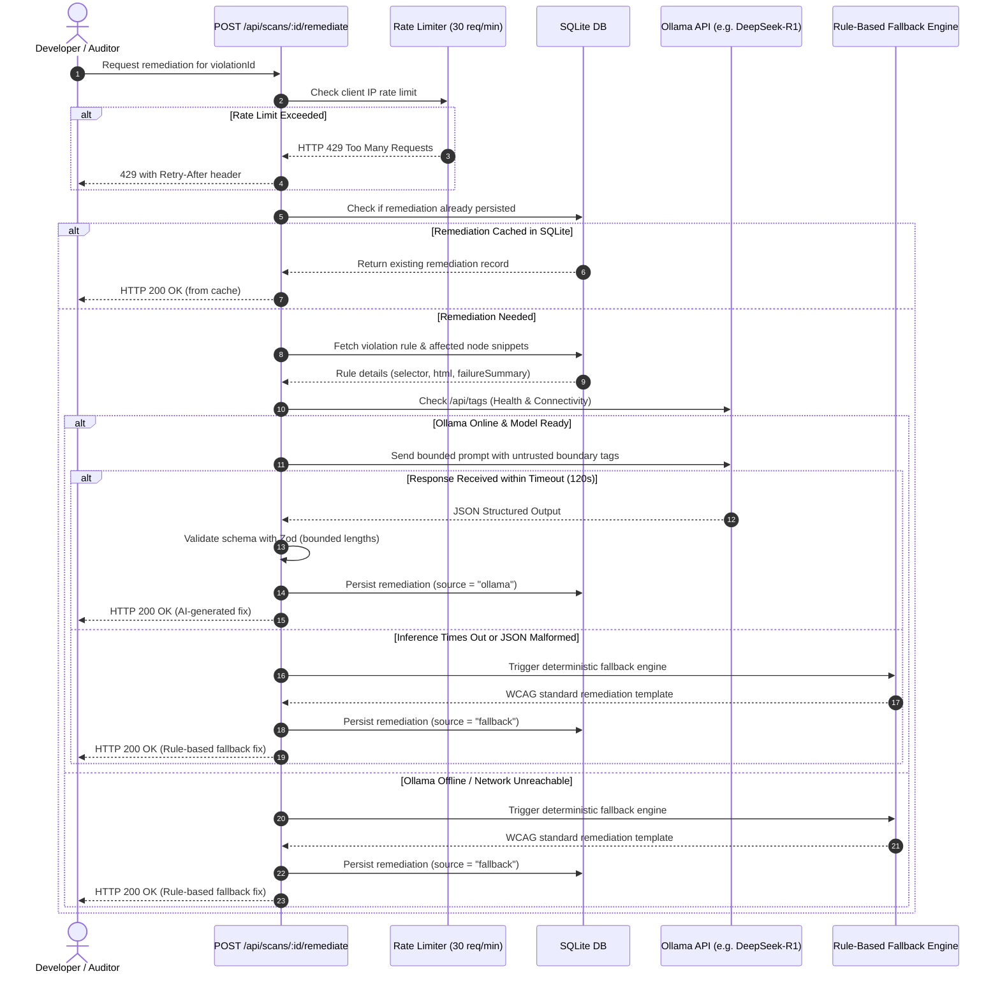
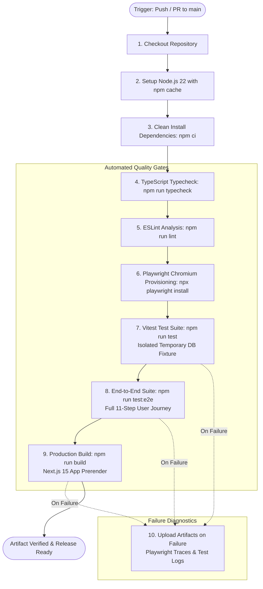

# AccessAI — System Architecture & Data Flow

This document details the architectural design, module boundaries, network trust perimeters, and asynchronous data pipelines of **AccessAI**.

---

## 1. High-Level System Architecture

AccessAI is built as a single-process, container-ready Next.js application that integrates headless browser orchestration, client-hydrated DOM accessibility analysis, persistent embedded relational storage, and local Large Language Model (LLM) remediation.



---

## 2. End-to-End Scanning Workflow

When an auditor or developer initiates a scan, the system transitions through a multi-stage pipeline:



---

## 3. AI Remediation & Deterministic Fallback Sequence

AccessAI guarantees that every identified violation receives an actionable, syntax-highlighted code fix—even when local LLM inference is offline or times out.



---

## 4. CI/CD Pipeline & Quality Gates

The continuous integration pipeline in `.github/workflows/ci.yml` enforces code quality, test isolation, and reproducible compilation on every pull request and push to `main`:



---

## 5. Trust Boundaries & Security Architecture

AccessAI evaluates arbitrary, third-party internet websites. This requires strict defense-in-depth across multiple system boundaries:

```
+-------------------------------------------------------------------------+
| UNTRUSTED EXTERNAL ZONE                                                 |
| - Target Websites (Arbitrary HTML, JavaScript, Redirects, DNS servers)  |
+-------------------------------------------------------------------------+
                                    |
                    [ 1. URL & Protocol Filter ]
                                    v
+-------------------------------------------------------------------------+
| SECURITY BOUNDARY: WHATWG Sanitizer & SSRF Resolver                     |
| - Strict http:/https: protocols only                                    |
| - Prohibits userinfo credentials (user:pass@host)                       |
| - Restricts ports to standard 80 and 443                                |
| - Asynchronous DNS pre-resolution via dns.promises.lookup               |
| - IP classification (ipaddr.js): blocks private, loopback, metadata     |
+-------------------------------------------------------------------------+
                                    |
                    [ 2. Pinned IP Outbound Socket ]
                                    v
+-------------------------------------------------------------------------+
| SECURITY BOUNDARY: Loopback Security Proxy                              |
| - Intercepts all Playwright browser socket connections                  |
| - Connects directly to pinned IP (mitigates TOCTOU DNS rebinding)       |
| - Evaluates all HTTP 3xx redirect destinations before traversal         |
+-------------------------------------------------------------------------+
                                    |
                    [ 3. Isolated Incognito Context ]
                                    v
+-------------------------------------------------------------------------+
| EXECUTION BOUNDARY: Headless Playwright Chromium                        |
| - Incognito session (no persistent cookies or storage)                  |
| - Flags: --no-first-run, --disable-background-networking                |
| - Blocks ServiceWorkers, WebSockets, and non-HTTP protocols             |
| - Hard navigation timeout: 30 seconds                                   |
+-------------------------------------------------------------------------+
                                    |
                    [ 4. Bounded Snippet Sanitization ]
                                    v
+-------------------------------------------------------------------------+
| TRUSTED INTERNAL APPLICATION ZONE                                       |
| - Snippet truncation (max 500 characters per affected node)             |
| - Prompt boundary tagging: <untrusted_webpage_code>                     |
| - Strict Zod validation on all AI outputs                               |
| - Embedded SQLite database with foreign keys & WAL mode                 |
| - Formula injection mitigation on CSV exports                           |
+-------------------------------------------------------------------------+
```

---

## 6. Architectural Trade-offs & Design Decisions

| Decision | Selected Approach | Alternatives Considered | Rationale |
| :--- | :--- | :--- | :--- |
| **Database** | Embedded SQLite 3 via `better-sqlite3` and Drizzle ORM | PostgreSQL / MySQL | Zero external infrastructure overhead for single-user and local dev; atomic transactions; fast queries; native WAL mode supports concurrent reads. |
| **Job Queue** | Single-process in-memory queue with DB state tracking | Redis + BullMQ / Celery | Eliminates external Redis dependency. Interrupted jobs are recovered on startup via `ScanRepository.recoverInterruptedJobs()`. |
| **Browser Runner** | Playwright Chromium with `@axe-core/playwright` | Puppeteer / JSDOM / Selenium | JSDOM cannot evaluate client-side React/Vue hydration or computed CSS contrast; Playwright provides robust process isolation and cross-platform reliability. |
| **AI Remediation** | Local Ollama with deterministic rule-based fallback | Cloud APIs (OpenAI / Anthropic) | Zero API key costs; strict privacy (audited DOM snippets never leave the host); offline reliability guaranteed by fallback engine. |
| **Report Generation** | PDFKit + CSV stringifier + JSON formatter | Browser `page.pdf()` printing | Server-side PDF generation via PDFKit requires no additional browser instances, reducing memory consumption by over 80%. |
